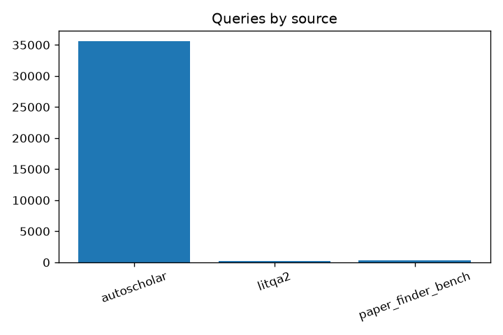
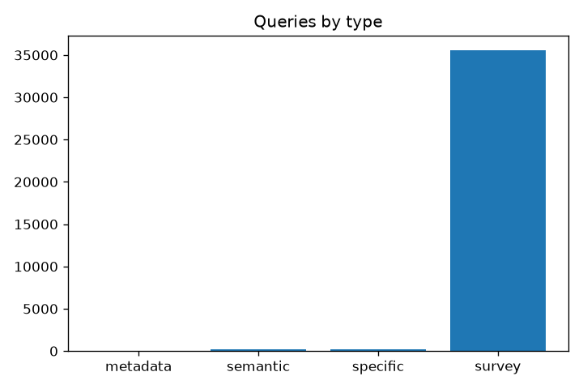

# 数据统计报告 (summary)

> 由 `stats.py` 自动生成。

## 1. 查询统计

- 总记录数：**36083**
- 按数据源：
  - `autoscholar`: 35551
  - `litqa2`: 199
  - `paper_finder_bench`: 333
- 按查询类型：
  - `metadata`: 43
  - `semantic`: 242
  - `specific`: 247
  - `survey`: 35551

### 查询长度

- 字符数：mean=101.9, median=99.0, p95=152.0, max=415
- token 数：mean=15.2, p95=23.0

### gold_papers 长度

- mean=2.60, median=2.0, p95=7.0, max=172

### 选项数分布 (LitQA2)

- 2 项: 7 条
- 3 项: 20 条
- 4 项: 106 条
- 5 项: 40 条
- 6 项: 16 条
- 7 项: 4 条
- 8 项: 4 条
- 9 项: 1 条
- 10 项: 1 条

## 2. 论文统计

- 唯一论文数：**100**
- 元数据来源：
  - `id2paper`: 24
  - `missing`: 76
- 含 abstract：0
- 含 authors：0
- 含 venue：0

### 字段缺失率

- `abstract`: 100.0%
- `authors`: 100.0%
- `venue`: 100.0%
- `title`: 76.0%

## 3. 字段缺失率 (queries)

- `correct_answer`: 99.4%
- `distractors`: 99.4%
- `gold_papers`: 0.5%
- `id`: 0.0%
- `options`: 99.4%
- `query`: 0.0%
- `scorer_criteria`: 99.3%
- `source`: 0.0%
- `type`: 0.0%

## 4. 图表

