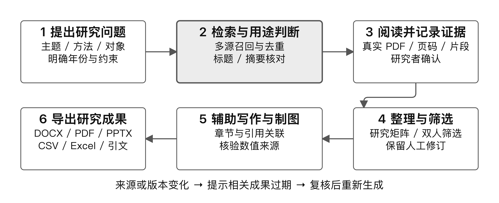
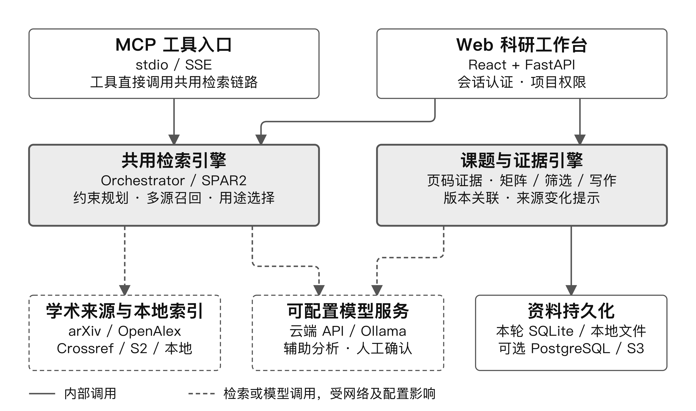
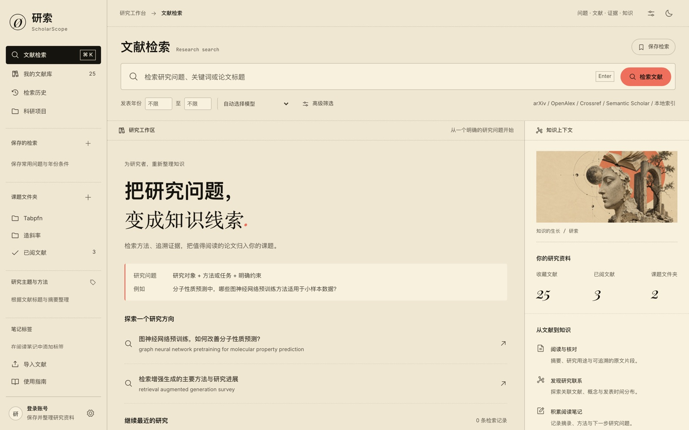

# 一、项目概述

## 1.1 应用背景

研究生和科研工程师的日常工作有三段彼此脱节的环节：先在检索工具里找文献，再在 PDF 阅读器里判断文献是否真的可用，最后在 Word 里复述结论。三段之间靠手工复制粘贴连接，结果是同一个判断被反复重做，结论的依据在写作时已经找不到。

现有工具各自只解决一段：通用搜索引擎不理解"研究对象 + 方法 + 年份约束"这类研究问题；文献管理器能存条目但不能判断相关性；通用对话模型能总结摘要，却无法保证总结里的每句话都能回到原文位置。真正耗时的工作——把一个研究问题拆成可执行的多步任务、调用多个学术数据源、对每一步结果做校验、把可核对的证据留给下一次使用——没有工具承担。

## 1.2 需要解决的问题

1. **任务无法自主执行**：用户输入的是一个研究问题，不是关键词，需要系统自己拆解检索步骤、选择工具、判断召回是否够用、决定是否补充检索。
2. **结果无法校验**：模型给出的推荐理由常常无法在检索到的标题或摘要中找到对应原文，评审和研究者都无法核对。
3. **过程不可追溯**：一次检索的结果、判断理由和后续写作用到的材料之间没有关联，来源变化后旧结论仍然被沿用。
4. **失败不可控**：任一数据源超时或模型不可用，整个流程就停摆，或者更糟——生成看似合理但不存在的论文。

## 1.3 项目目的

研索 ScholarScope 把"提问 → 多源检索 → 论文阅读与判断 → 证据整理 → 文稿与演示交付"做成一条由 Agent 实际执行、每一步都可核对的任务链。目标不是在聊天框里回答问题，而是让用户在一次任务结束后拿到三样东西：按研究用途排序的文献、能落回原文位置的证据、可直接继续编辑的产物。

## 1.4 创新点

1. **按研究用途组织推荐，理由回落到原文**。推荐理由必须基于检索到的标题或摘要，界面可展开查看证据片段；引用量和期刊声望不参与排序。这直接针对"通用模型推荐无法核对"的问题。
2. **约束在每一轮检索中被保留，而不是被放宽**。研究问题中的主题、方法、研究对象和年份条件会送到 arXiv、OpenAlex、Crossref 等来源执行，并在合并后再次核对；不为凑数量放宽条件。
3. **失败即降级，绝不编造**。每个阶段有独立时间预算，单源故障不阻塞整体；全源失败返回空结果而不是占位论文；模型不可用时保留原文整理与人工流程，并在界面标注实际生成模式。
4. **证据对象贯穿产物**。证据保存来源、页码与原文片段及其哈希，矩阵、问答、综述、图表和演示报告都引用同一批证据；来源变化会把依赖它的产物标记为待复核。
5. **Web 与 MCP 共用同一条执行链路**。网页工作台和 MCP 工具（stdio / SSE）调用同一个 Orchestrator，避免两套逻辑漂移，也让 Agent 能力可被外部编辑器直接使用。

# 二、技术方案

## 2.1 总体架构

系统分为四层：入口层（Web 工作台与 MCP 工具）、任务层（Orchestrator 与 SPAR2 检索链路、受限工具执行与任务状态）、证据层（项目、文献、页码片段、证据与产物关联）、存储层（默认 SQLite 与本地文件，可选 PostgreSQL/pgvector 与私有 S3）。

选择"单进程 FastAPI + 可切换存储"而不是微服务，是为了让一名学生团队能在一台笔记本上完整运行并现场演示；容器模式提供等价的 Postgres 与 S3 配置，部署形态变化不影响上层接口。

## 2.2 功能概述（任务闭环）

一次完整的 Agent 任务按下列顺序执行，每一步的中间结果都可在界面查看：

| 阶段 | 系统行为 | 用户可见内容 |
|:--|:--------|:-------|
| 任务理解 | 把研究问题转成标准学术术语与聚焦检索短语，保留方法、对象、年份约束 | 查询规划结果 |
| 步骤规划 | 生成工具计划（检索、全文本地解析、矩阵提取、问答、写作、图表），写入任务记录 | 任务面板中的计划 |
| 工具执行 | 并行检索多个学术来源，合并 DOI / arXiv 别名并去重；沿已召回文献的参考文献扩展候选 | 每轮新增、重复、拒绝数量 |
| 结果校验 | 推荐理由须在标题或摘要中有对应原文；证据提交前核对片段是否真实存在于原文 | 证据片段与核验状态 |
| 人工确认 | 证据核验阶段等待项目编辑者确认后继续 | 待复核清单 |
| 产物交付 | 生成 DOCX、PPTX、PDF、Markdown、CSV/Excel、BibTeX/RIS/JSON 与私有来源清单 | 下载入口与来源备注 |

任务支持取消、失败重试与中断恢复；已完成的步骤和产物在中断后保留。

## 2.3 模型与工具

| 类别 | 具体内容 | 说明 |
|:--|:-------|:------|
| 学术数据源 | arXiv、OpenAlex、Crossref、Semantic Scholar、Europe PMC、本地文献索引 | 并行调用；配置授权密钥后启用 Scopus，Crossref Plus 为可选配额；2026-10-14 已按各来源正式接口核对 |
| 模型 | OpenAI 兼容接口（DeepSeek、通义千问、GLM、Kimi 等）、本地 Ollama、自建端点 | 页面注册、持久化、连通性测试与优先级路由；未配置模型时按文本匹配降级 |
| 语义检索 | sentence-transformers 多语言模型 `paraphrase-multilingual-MiniLM-L12-v2` | 本地缓存加载，不在请求中下载；缺失时回退关键词检索 |
| 文档处理 | PDF 页级解析、Poppler/Tesseract OCR（扫描页）、本机字体渲染 | 扫描页保留识别置信度与位置 |
| 外部系统 | Zotero 个人/群组库 Web API、OpenAlex 引用关系、开放获取 PDF 检索 | 密钥按账号加密保存，不进入项目产物包 |
| 导出 | python-docx / python-pptx / 服务端 PDF / 原生 Office 图表 | PPTX 服务端导出需要 Node.js 与 `npm ci --prefix frontend` |

## 2.4 关键技术

**（1）保留约束的迭代检索。** 研究问题先被拆为主题、方法、研究对象和年份四类要素；年份条件同时下发到 arXiv、OpenAlex、Crossref，并在合并后再次校验，日期缺失的文献在指定年份时不进入结果。补检索在同一预算内最多执行八轮，达到目标数量即停止，不为凑数量放宽条件；每轮记录新增、重复、拒绝数量与停止原因。

**（2）合并去重与版本关联。** 多源结果按 DOI 与 arXiv 别名归一，同标题且作者相符的预印本与出版版本保留关联关系，不重复计数，原始证据各自保留。

**（3）带证据的用途选择。** 候选文献进入判断阶段时，模型只能引用已知片段 ID，后端负责附上原始片段，避免模型改写引文；未知或错引标记被拒绝。推荐理由整体还要经过一次语义核对，核对不通过则退回原文整理。

**（4）受限工具执行。** 任务执行在受限子进程中运行，工具走白名单，最多同时执行两个任务，每个阶段有时间预算（检索预算 50 秒、最终用途选择最多 32 秒、接口保护上限 95 秒；补检索共享 210 秒）。超时即降级，不累积阻塞。

**（5）证据失效传播。** 证据带来源哈希与文档位置；修改证据会把依赖它的矩阵、综述、演示标记为待复核；来源变化检查在导出前提示。问答、综述和演示报告保留来源关系，避免旧结论悄然沿用。

## 2.5 稳定性与校验措施

- 检索阶段异常返回脱敏的服务不可用提示，不把提供商原始错误写入响应或日志；失败不生成占位论文。
- 模型超时、返回无效引用或语义核对失败时，回退到原文整理，并在界面标明实际生成模式与章节覆盖；资料不足时明确说明。
- 项目角色（owner / editor / viewer）由服务端校验；身份取有效会话，不接受客户端传入的用户名。
- 账号、收藏、已阅、文件夹与导入按账号隔离；未登录用户进入共享匿名空间。
- 证据不能提交不在原文中的片段；矩阵中人工修改的单元格不会被批量重跑覆盖。

# 三、项目计划

## 3.1 可行性分析（含使用成本与数据安全）

**技术可行。** 全部能力已在本地实现并可运行：FastAPI 后端、React 工作台、MCP 服务、PDF 解析、证据与产物流程均已交付；不依赖任何指定平台或付费模型，作品在本机即可演示。

**资源可行。** 单人笔记本可完成检索、阅读与产物生成；需要联网访问学术来源，模型可选本地 Ollama 或自备云端 API Key。容器模式可选用 PostgreSQL/pgvector 与私有 S3，用于更大规模的资料量。

**成本可控。** 检索链路以开放学术来源为主，无强制付费额度；语义模型为约 470MB 的本地开源模型，只在本地推理；云端模型按用户自备额度调用，页面可设置优先级与端点，避免误用高价模型。

**数据安全。** 密钥只填网页表单并按账号加密保存，不写入日志与产物包；下载开放全文时限制 25MB、校验公开 DNS 与每次跳转、固定连接地址并保留 TLS 证书验证；项目资料与文稿默认保存在忽略提交的本地目录。

## 3.2 团队分工

| 角色 | 分工 | 说明 |
|:---|:---|:------|
| 项目负责人（杨亚洲） | 系统设计、检索链路与证据模型实现、自动化验收与文档 | 常州大学计算机与人工智能学院，计算机科学与技术 |
| 团队成员 | 待补充（报名表填写） | 每队 1—5 人，成员分工以报名表与现场答辩说明为准 |
| 指导教师（可选） | 选题指导与专业建议 | 按报名表填写 |

## 3.3 当前完成情况

截至 2026-11-03，系统在本机实际运行，回归测试与界面均已复验：

| 验证项目 | 结果 | 范围与核验依据 |
|:---|:---|:------|
| 自动化回归 | 148 项通过，0 项失败（48.90 秒） | 2026-11-03 本机实测 `pytest tests/ -q`，覆盖账号与权限、检索、证据、矩阵、写作、演示与文件导出 |
| 其中用户流程 | 24 项通过 | 含 21 组场景及参数化用例，计入上述 148 项，不重复累计 |
| 服务与页面 | 首页 `/`、工作台 `/app` 均返回 200 | 2026-11-03 启动 `uvicorn web.app:app` 实测 |
| 界面与图示 | 通过 | 图 3、图 4 为 2026-11-03 当前版本实机截图；图 1、图 2 由仓库内可编辑矢量源（`比赛材料/江苏省青年发明家大赛/图表源文件/`）导出，非示意图 |
| 文件与导出 | 通过 | PDF 解析；DOCX、PPTX、图表及四类引文文件往返 |
| 异常与账号隔离 | 通过 | 拒绝伪造证据与越权；检索故障返回安全提示，不泄露内部错误、不生成虚构论文 |
| 浏览器全流程脚本 | 5 组未在本轮执行 | 本轮执行环境限制本地端口监听；脚本语法检查通过，不代表浏览器操作通过 |
| 真实环境联调 | 4 类待验证 | 真实检索质量、云端模型质量、私人 Zotero 账号、最新版容器与存储联调 |
| 软件著作权 | 申请材料已备齐，尚未取得证书 | 不作为已获成果表述 |

如实说明：148 项通过不等于完整产品验收，当前总体状态为验收未完成，研究者试用待开展。真实检索质量已有一次记录：以"深度学习测井曲线预测孔渗参数"为目标 30 篇的验收中，首次仅得到 2 篇，补检索在约 210 秒、3 轮内保存 10 个真实候选，仍未达到目标数量——系统保留了实际状态，未补造论文。

## 3.4 交付与演示计划

| 时间节点（大赛赛程） | 交付内容 | 当前状态 |
|:----|:-------|:--|
| 报名 2026-10-30 至 11-20 | 附件 3 报名表 | 已提供空白模板，个人信息由团队填写 |
| 作品征集 2026-11-10 至 11-25 | 项目计划书 PDF、演示视频 MP4、可运行原型与操作说明 | 计划书与操作说明已完成；演示视频待录制，分镜脚本已备 |
| 初赛评审 2026-11-25 至 11-30 | 材料补正 | 按评审反馈修订 |
| 线下决赛（暂定 2026-12-12） | 现场演示 PPT、完善后的作品与运行材料、5 分钟路演 + 3 分钟问答 | PPT 初稿已完成（16 页），需按 5 分钟节奏压缩 |

现场演示按"输入研究问题 → 查看查询规划 → 查看每轮检索与工具调用 → 打开推荐理由的证据片段 → 在项目中生成矩阵与文稿 → 导出 PPTX"的顺序进行，展示内容与提交成品一致。

## 3.5 已知局限与迭代计划

**已知局限。** 浏览器端到端用例本轮未执行；真实云端模型质量与私人 Zotero 账号联调未完成；综述与演示的 AI 综合目前只覆盖部分章节，缺口会如实标注；跨语言检索质量在长尾领域仍不稳定。

**迭代计划。** ①补齐浏览器、部署与接口环境的复验条件，把"脚本语法通过"推进为"浏览器操作通过"；②固定评测配置（问题集、标注规则、模型版本与失败记录），量化任务完成率与结果准确率，而不是只报用例数量；③以真实课题开展研究者试用，观察检索、证据核验与资料沉淀是否连贯；④按使用反馈决定性能与覆盖面投入，暂不增加工具数量。

# 四、资源与自主贡献声明

**开源框架与第三方资源。** 后端 FastAPI / Uvicorn、前端 React + Vite、PDF.js、python-docx / python-pptx、sentence-transformers（`paraphrase-multilingual-MiniLM-L12-v2`）、Poppler 与 Tesseract，均为公开发布的开源组件，许可证清单保存在 `docs/implementation/dependency-licenses.json`，构建脚本中包含许可证审计。学术数据来自 arXiv、OpenAlex、Crossref、Semantic Scholar、Europe PMC 的公开接口；Zotero 通过官方 Web API 接入。

**模型使用。** 系统本身不训练基础模型，通过 OpenAI 兼容接口调用用户自备模型（含本地 Ollama）。模型只负责查询理解、用途判断与章节组织；引用必须落回检索到的原文片段，否则被拒绝。

**团队自主贡献。** 检索链路与 Orchestrator、SPAR2 查询规划与补检索、证据对象与失效传播、任务执行与预算降级、矩阵/问答/综述/演示的产物流程、账号与项目权限、自动化回归与验收脚本、界面与文档均由本团队实现；差异点与边界在 README 与 `docs/` 中有逐项记录。

**原创性。** 本作品为团队自主选题、自主设计与自主实现，引用开源框架与第三方资源处均已标注来源，未抄袭、套用他人成果。

# 五、可核验材料位置

| 材料 | 位置 |
|:-----|:--------|
| 系统说明与功能范围 | `README.md` |
| 架构与模块边界 | `docs/implementation/research-platform-architecture.md` |
| 验收记录与边界 | `docs/implementation/research-workspace-verification.md`、`docs/testing/user-acceptance.md` |
| 依赖与许可证清单 | `docs/implementation/dependency-licenses.json` |
| 自动化回归 | `src/tests/`（`python3 -m pytest tests/ -q`） |
| 用户验收脚本 | `src/tests/run_acceptance.py`（含 Playwright 五组用例） |
| 本计划书图表与截图源 | `比赛材料/常州大学智能体大赛/源文件/` |
