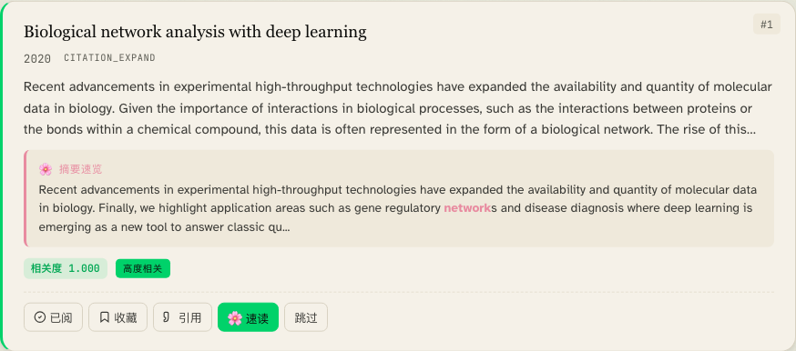
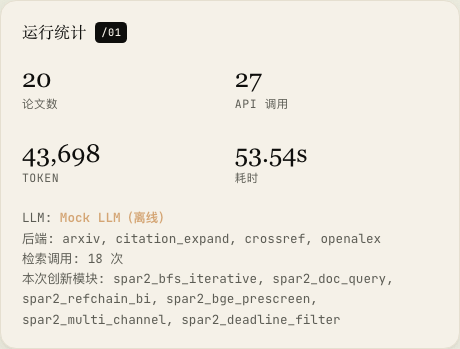
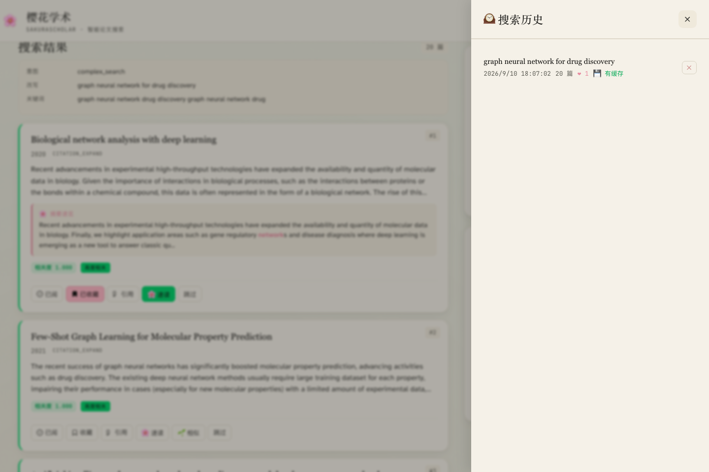
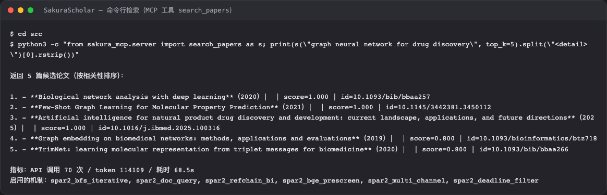
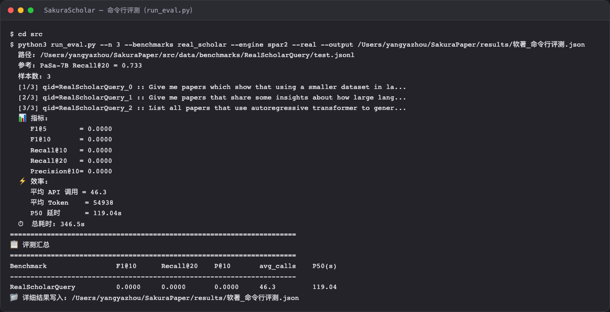
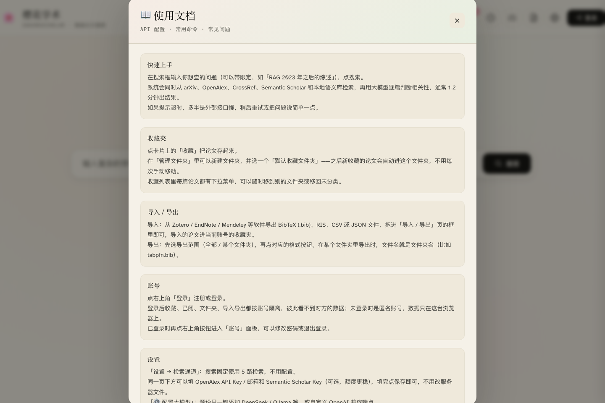
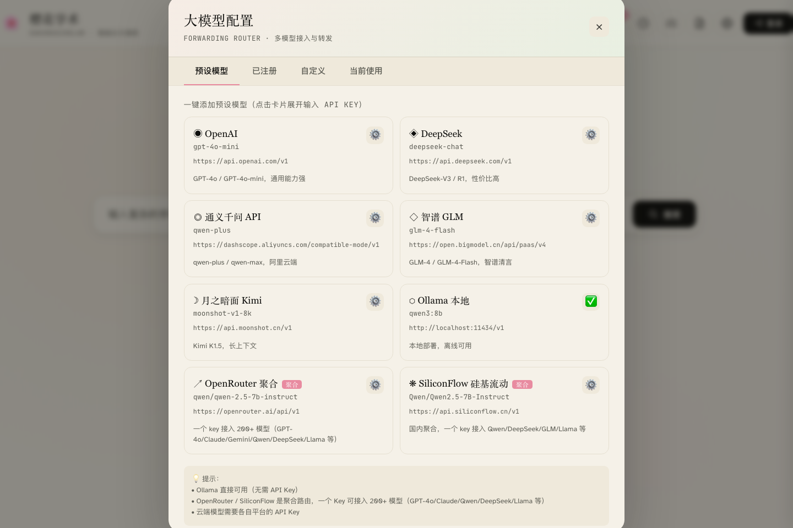
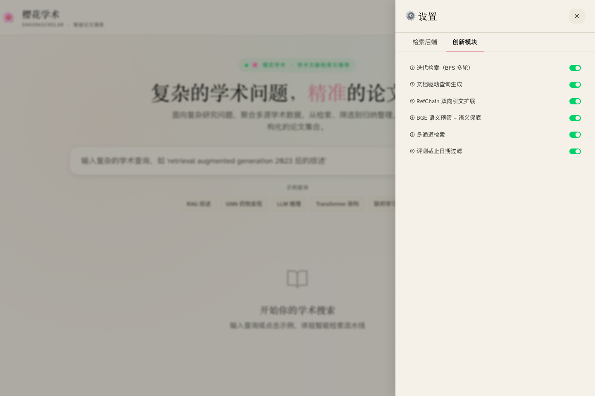

# 智能学术文献检索与分析软件操作手册

## 一、相关文档

| 文档名称 | 指向资料 | 说明 |
| --- | --- | --- |
| 总体设计 | 《总体设计》 | 说明软件整体功能、页面组成、运行环境和业务边界。 |
| 详细设计 | 《详细设计》 | 说明各功能页面、输入输出、状态变化和处理规则。 |
| 测试案例 | 《测试案例》 | 记录主要功能的操作场景、预期结果和异常提示。 |

## 二、说明

智能学术文献检索与分析软件 V1.0适用于学术信息服务 / 科研数据智能检索与知识服务场景。用户进入系统后，可以围绕实际工作内容完成账号进入、业务创建、过程查看、结果确认和资料管理等操作。

日常使用时，科研工作者与高校师生、开展文献调研与综述的研究者、情报检索与知识管理研究人员可以按照页面提示从入口进入相应页面，查看当前业务状态，并根据页面中的按钮、输入框、列表或弹窗继续处理。把“一段复杂、模糊的学术问题”处理成一次多源检索与引文扩展：先理解查询意图，再从真实学术数据源召回候选，随后沿引用关系迭代扩展论文网络，最后用统一的比对与关系视图帮助研究者高效定位相关文献。

面向科研工作者的端到端学术文献检索、引文扩展与排序分析平台：对复杂学术查询做理解、多渠道检索、迭代扩展与结构化结果展示，并支持反馈使用跟踪与智能服务评测。

本手册用于说明软件的用途、功能特点、运行要求和页面操作流程。各功能章节按用户能够看到的页面、入口、按钮、输入项、提示信息和处理结果进行说明。

## 三、功能特点

Web 端检索与结果页（主工作台）页面提供输入学术问题、发起检索、查看结构化结果与配置智能服务/数据源的可视化操作台。页面上的查询输入区与查询规划结果、多源检索进度与状态的展示、结果列表/JSON 明细/对比表/关系图查看区、单篇论文详情与参考文献/被引扩展入口和智能服务与数据源配置区会集中呈现当前可操作内容，用户处理完成后可以看到页面显示检索状态与查询规划；结果以三类结构化视图呈现；配置/登记成功与失败均有明确提示。

在命令行与编程数据通道：检索、评测与收藏页面中，用户主要处理把检索、引文扩展、个人收藏与基准评测能力开放成命令行或本地服务，便于在脚本、其它编码工具里调用与批量执行。系统把各能力入口：检索、单篇详情、参考文献/被引、收藏、评测和输出到界面/脚本的 JSON 结果与评测汇总放在当前操作区域，处理结束后会反馈命令行打印调用结果、进度与评测指标；评测完成后输出汇总与失败样例文件。

复杂学术查询理解与查询规划：软件把用户输入的一段描述性学术问题解析为关键词检索词与语义短语，形成可执行的查询规划，并在结果页给出意图、改写查询与关键词等规划信息。

多渠道文献检索与语义预排：软件并发访问 arXiv、OpenAlex、CrossRef、Semantic Scholar 等真实学术数据源，并配合本地语义语料检索，随后按语义相关性对候选论文做预排序。

迭代式引文双向扩展：软件对命中论文网络同时查看其参考文献与被引用情况（RefChain 双向扩展），逐层扩大相关文献范围，接近多轮迭代检索的效果。

结构化三件套结果输出：软件把一次查询与其检索结果整理为 JSON 明细、Markdown 对比表与自包含 HTML 关系图，可离线打开查看。

检索反馈闭环与个性化收集：软件记录用户对结果的已阅、收藏、引用、跳过等反馈事件，支持收藏夹、已阅标记、文件夹归类与批量导入导出，沉淀为个人文献库。

多模型评测与离线复现：软件内置学术基准评测集与可离线运行的评测流水线，支持多模型对照，输出检索指标与失败样例；无外部服务时仍可复现基础结果。

账号与权限管理：软件支持注册、登录、修改密码与会话保持，收藏夹、已阅与个人库按账号隔离；管理员账号可维护内置帮助文档与数据源配置。

## 四、系统要求

| 系统要求 | 最低配置 | 推荐配置 |
| --- | --- | --- |
| 操作系统 | Windows 10 / macOS / Linux，能运行 Python 3 环境。 | Windows 11 / macOS / Linux，配备可用的 Python 虚拟环境 |
| 运行环境 | Python 3 及依赖；普通电脑可离线运行 | 能联网访问学术数据源并可按需配置大智能服务数据通道；本地语义复现建议足够内存 |
| 浏览器 | 支持现代浏览器（Chrome / Edge / Safari / Firefox） | 建议使用 Chrome 或 Edge 最新版本 |

请确保实际运行环境满足以上要求，以保证智能学术文献检索与分析软件能够正常打开页面、提交操作和展示处理结果。若部署方式、客户端形态或服务器环境与本表不同，应以实际确认的申请表环境字段为准。

## 五、Web 端检索与结果页

Web 端检索与结果页（主工作台）页面提供输入学术问题、发起检索、查看结构化结果与配置智能服务/数据源的可视化操作台。用户可以通过启动 Web 服务后在浏览器打开入口页面进入检索主界面。

研究者想对一个具体学术问题做系统检索，并查看命中文档的关系图、对比表，或对结果收藏/反馈时使用。

用户在Web 端检索与结果页（主工作台）页面会看到查询输入区与查询规划结果、多源检索进度与状态的展示、结果列表/JSON 明细/对比表/关系图查看区、单篇论文详情与参考文献/被引扩展入口、智能服务与数据源配置区和反馈与收藏按钮等信息，并可依据页面显示继续处理。

页面顶部工具栏依次提供我的收藏夹、搜索历史、配置大模型、使用文档与设置入口；页面右上角显示当前登录账号，未登录时显示登录入口。

结果区左侧为结果列表，每张论文卡片显示标题、发表信息、来源数据通道、相关度与摘要速览，并提供已阅、收藏、引用（导出 BibTeX）、速读、相似文献与跳过按钮；右侧为运行统计与文献星图。

文献星图把命中的论文按相似度连成图，节点大小与颜色对应当前相关度高低，便于观察主题簇与关键文献。

配置区支持登记大模型与数据源：可查看预设模型、已注册模型与当前使用模型，也可自定义名称、模型、接口地址与密钥，并先测试连通性再保存。

使用该功能时，用户先在输入区输入一段学术问题，随后如需真实检索或调用大智能服务，先在配置区登记并选择可用的数据源和智能服务供应商，接着点击发起检索，等待系统完成查询规划、多路召回与引文扩展，之后在结果区查看命中结果：论文卡片按相关性排序，卡片上可展开摘要速览并查看相似文献，右侧文献星图展示论文之间的关联，再打开单篇论文可查看详情并可沿参考文献或被引继续扩展，最后对满意的记录收藏并对结果给出反馈；查看反馈汇总了解使用效果。

页面会按照使用真实数据源需网络可用；离线/未配密钥时软件可进入离线复现模式，部分数据通道不同步和智能服务供应商与密钥按页面登记后保存生效，登记前仅使用离线演示能力等规则限制或提示用户。处理结束后，用户可以看到页面显示检索状态与查询规划；结果以论文卡片列表、运行统计与文献星图呈现；配置/登记成功与失败均有明确提示。

## 六、账号与个人文献库

软件支持注册与登录：点击右上角登录入口，可在登录与注册页签之间切换，注册成功后当前账号显示在右上角；登录状态下可以修改密码或退出登录。

我的收藏夹按账号隔离保存用户收藏的论文，支持按文件夹查看，并可新增、重命名、删除文件夹以及设置默认收藏文件夹。

导入支持 BibTeX (.bib)、RIS、CSV、Zotero JSON 与 EndNote XML：在文献管理软件中导出后，把文件拖入导入框或点击选择文件即可，导入的论文进入当前账号的收藏夹。

导出支持 BibTeX（Zotero / LaTeX）、RIS（EndNote / NoteExpress）、CSV（Excel 表格）与 JSON（Mendeley 兼容），可限定导出全部收藏或某个文件夹。

已阅标记与搜索历史：点击论文卡片上的已阅按钮即可标记已读；搜索历史记录每一次查询与命中数量，并支持一键恢复上一次的检索结果。

## 七、命令行与编程数据通道：检索、评测与收藏

用户可在命令行与编程数据通道：检索、评测与收藏页面把检索、引文扩展、个人收藏与基准评测能力开放成命令行或本地服务，便于在脚本、其它编码工具里调用与批量执行。用户可以通过安装依赖后，在本机启动命令行或本地服务入口，按文档用相应命令或工具名调用。

使用者想让结果直接进入自己的脚本、让第三方界面一键调用检索能力，或在电脑上批量跑某评测集比较智能服务时使用。

该部分提供各能力入口：检索、单篇详情、参考文献/被引、收藏、评测和输出到界面/脚本的 JSON 结果与评测汇总等页面内容，用户可据此查看状态、填写信息或选择下一步操作。

在该页面中，用户先启动命令行或本地服务并确认连接成功，随后调用检索能力输入欲查询的学术问题，按返回取用结果，接着按需调用单篇详情、参考文献或被引以扩展某条文献，之后调用收藏能力把关注的论文加入个人库，最后需要度量效果时运行评测入口，对指定基准集跑对照并查看指标与失败样例。

如果不满足此模式下未配置智能服务/密钥或断网时，检索走离线复现分支，返回仍可用和评测需在可访问相应数据或缓存时才有意义；结果以本地输出文件为准等要求，用户需要根据页面提示调整后再继续。页面反馈通常包括命令行打印调用结果、进度与评测指标；评测完成后输出汇总与失败样例文件。

软件同时提供 MCP（Model Context Protocol）服务，把上述能力暴露为标准工具，支持 MCP 的客户端可直接调用：search_papers（多通道检索）、get_paper（论文详情）、get_references（参考文献）、get_citations（被引文献）、save_favorite / list_favorites（收藏与个人库）、run_eval（基准评测）。

## 八、内置帮助文档与数据源配置

内置帮助文档：点击工具栏的文档入口可查看使用说明、常见问题与数据源配置说明；管理员登录后可直接在弹窗中编辑并保存，保存后的内容对所有用户生效。

大模型配置：在配置大模型弹窗中可查看预设模型、已注册模型与当前使用模型，也可以自定义模型名称、模型标识、接口地址与密钥，并先测试连通性再保存。

数据源与检索后端配置：在设置抽屉中可登记 OpenAlex 与 Semantic Scholar 的密钥与邮箱，密钥保存后脱敏显示（仅管理员可修改），并可查看各检索后端与创新模块的开关状态。

## 九、典型使用流程

用户完成一次完整业务时，通常先进入智能学术文献检索与分析软件，再选择或创建业务对象，随后按照页面提示处理内容并查看结果。

在应用入口输入一段学术问题或补全任务所需信息；未配置大智能服务时可离线演示；如提示需要访问真实文献库或大智能服务，先在 Web 端配置或切换对应的数据源数据通道与智能服务供应商；提交查询后查看检索进度：系统先做查询理解，再多渠道召回并结合语义预排；在结果页查看 JSON 明细、Markdown 对比表与关系图，沿引用与被引继续扩展相关文献。

## 十、常见问题解答

问题：没配置任何大智能服务或网络不能访问真实数据源，软件还能用吗？

解决方法：可以。软件提供离线复现分支，未配置智能服务时仍能演示检索与评测的基础能力；真实数据通道与智能服务需在配置后使用。

问题：结果在哪里看、存到哪里？

解决方法：Web 端可在主界面直接查看 JSON 明细、对比表和关系图；命令行/评测入口会把产物写到指定输出文件。

问题：所谓的引文扩展是什么意思？

解决方法：对命中论文同时向外看它的参考文献与被谁引用，不断把相关文献带进来，尽量完整覆盖一个主题的脉络。

问题：三件套输出是必须的吗？

解决方法：软件统一生成 JSON、Markdown 对比表与关系图，便于不同使用偏好；收藏会在个人库中沉淀。

问题：怎么把检索结果导入到 Zotero 等文献管理软件？

解决方法：在结果卡片上点“引用”可复制该论文的 BibTeX；也可以先把论文收藏，再到收藏夹的“导入 / 导出”页按 BibTeX、RIS、CSV 或 JSON 导出。

问题：为什么有的结果没有相关度数值或摘要？

解决方法：外部数据源未返回摘要时卡片会显示“暂无摘要”；相关度由本地语义预排与判分结果综合给出，未配置可用的大模型时会退化为离线判分，数值偏低属正常现象。

## 十一、术语表

| 术语 | 解释 |
| --- | --- |
| 学术数据源 | 提供论文检索与元数据的服务，如arXiv、OpenAlex、CrossRef、Semantic Scholar。 |
| 召回 | 从一个问题里先把候选对象取回来，再排序精筛；召回尽量多、排序尽量准。 |
| 被引用/引用 | 某文被别人引用(被引)与它本身引用了谁(引用)，软件用来向外扩展论文网络。 |
| 语义语料 | 一份本地可检索的论文标题/内容集合，结合向量手段做相似匹配，作为其一数据通道。 |
| 关系图 | 把查询命中的论文按相似度连成图的可视化，方便看主题簇与关键文献。 |
